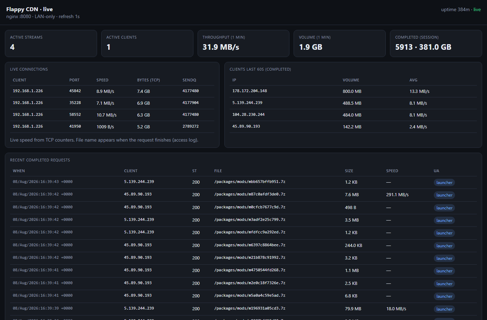

# Flappy CDN · live dashboard

<p align="center">
  <strong>LAN-only monitor for Flappy Launcher package downloads</strong><br/>
  <sub>nginx access log + live TCP · zero npm/Node deps · one <code>install.sh</code></sub>
</p>

<p align="center">
  
</p>

<p align="center">
  <em>Example snapshot from a real CDN host: active streams through NPM, completed <code>.7z</code> pulls, per-client volume.</em>
</p>

---

## What you see

| Panel | Meaning |
|--------|---------|
| **Active streams** | Open TCP connections to the CDN port right now |
| **Active clients** | Distinct peers (after `real_ip` / X-Forwarded-For: real players, not only the proxy) |
| **Throughput / volume (1 min)** | From completed access-log lines |
| **Live connections** | Per-socket speed via `ss` (`bytes_acked` deltas) |
| **Clients last 60s** | Who finished transfers recently |
| **Recent completed requests** | Path, size, status, optional speed, UA (`launcher` pill) |

File names appear when a request **finishes** (nginx access log). Live speed for in-flight transfers comes from TCP counters.

---

## Architecture

```text
Players ──HTTPS──► NPM / reverse proxy ──HTTP──► CDN nginx :8080
                                                    │
                         access.log ────────────────┤
                         TCP :8080 (ss) ────────────┤
                                                    ▼
                                         dashboard :8090  (LAN only)
```

Works with the [Flappy Launcher](https://github.com/PinyaGit/flappy-launcher) layout (`index.json`, `packages/**/*.7z`), or any static nginx CDN.

---

## Install (on the CDN container / LXC)

```bash
git clone https://github.com/PinyaGit/flappy-cdn-dashboard.git
cd flappy-cdn-dashboard

sudo ./install.sh \
  --with-nginx \
  --proxy-ip 192.168.1.226 \
  --access-log /var/log/nginx/cdn.flappy.su.access.log \
  --nginx-port 8080 \
  --port 8090
```

Then open from a PC on your LAN:

```text
http://<cdn-host-ip>:8090/
```

| Flag | Purpose |
|------|---------|
| `--with-nginx` | Add `log_format cdn_timed` (`$request_time`), wire `access_log … cdn_timed` |
| `--proxy-ip` | `set_real_ip_from` for NPM (so logs/UI show real client IPs) |
| `--access-log` | Path to nginx access log |
| `--nginx-port` | CDN listen port used by live `ss` |
| `--allow` | Who may open the UI (default: `192.168.,10.,127.0.0.1,::1`) |
| `--uninstall` | Remove unit + `/opt/cdn-dashboard` |

**After install**

| Path | |
|------|--|
| UI / API | `http://<host>:8090/` · `/api/live` · `/health` |
| App | `/opt/cdn-dashboard/server.py` |
| Env | `/etc/default/cdn-dashboard` |
| Unit | `cdn-dashboard.service` |

```bash
systemctl status cdn-dashboard
journalctl -u cdn-dashboard -f
curl -s http://127.0.0.1:8090/api/live | head
```

---

## NPM (reverse proxy) tips

For large launcher packages (`.7z` + Range):

1. **Disable Response Buffering** → ON  
2. **Disable Request Buffering** → ON  
3. Pass **X-Forwarded-For** / **X-Real-IP** (needed for real client IPs on the dashboard)  
4. Long proxy timeouts (`proxy_read_timeout` / `proxy_send_timeout` ≥ 3600s)  
5. **Do not** cache huge package assets

Without (1), a second downloader often sits at **0%** while the first transfer buffers through NPM.

---

## Security

- Requests from outside `CDN_DASH_ALLOW` get **403** (LAN-oriented by default).  
- No public domain required — bind IP + port is enough.  
- Runs as **root** on a dedicated CDN LXC so it can read `/var/log/nginx` and run `ss`.

---

## Repo layout

```text
flappy-cdn-dashboard/
├── install.sh                 # one-shot installer
├── server.py                  # dashboard (Python 3 stdlib only)
├── cdn-dashboard.service      # systemd unit
├── cdn-dashboard.env.example
├── docs/
│   └── dashboard-preview.png  # README screenshot (example state)
├── scripts/
│   └── nginx-cdn-timed.conf.snippet
├── README.md
└── LICENSE
```

---

## Uninstall

```bash
sudo ./install.sh --uninstall
```

---

## License

MIT — see [LICENSE](LICENSE).

Related: [flappy-launcher](https://github.com/PinyaGit/flappy-launcher)
